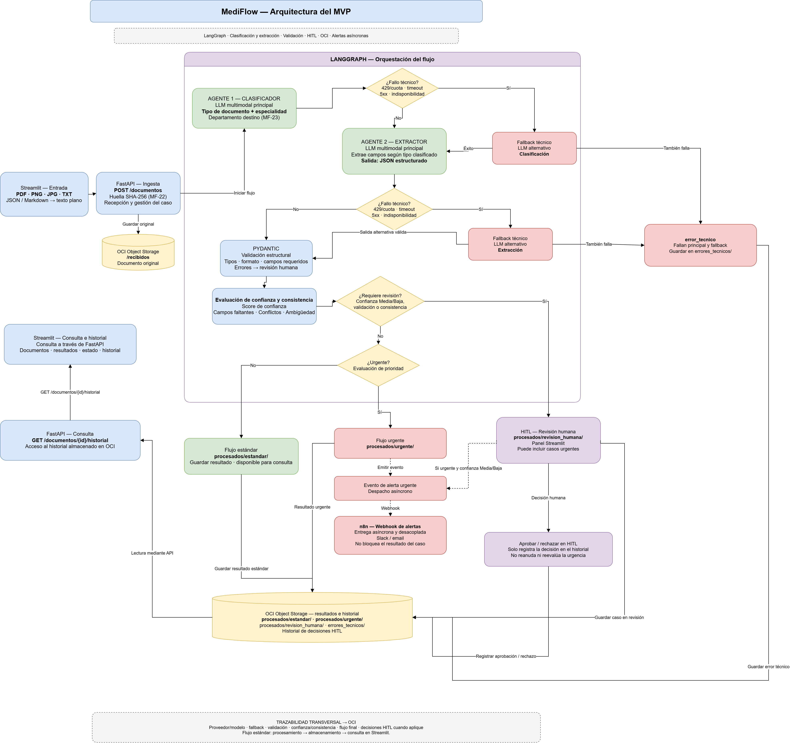

# MediFlow

Sistema inteligente para procesamiento y triaje de documentos clínicos.

Proyecto desarrollado para Hackathon ONE G10.

## Descripción general del proyecto

MediFlow es un sistema inteligente basado en agentes de IA para el triaje, extracción y enrutamiento de documentos clínicos. El sistema recibe documentos clínicos y administrativos en distintos formatos (PDF, imagen o texto), los clasifica automáticamente, extrae los datos esenciales con un LLM multimodal, y los enruta al destino correcto según su nivel de urgencia y confianza de extracción — sin intervención humana manual para los casos estándar.

Proyecto desarrollado para el Hackathon ONE G10 (Oracle Next Education & Alura).

## Objetivo del proyecto

Reducir el tiempo y los errores del procesamiento manual de documentos clínicos en hospitales, laboratorios y aseguradoras de salud, mediante un pipeline automatizado de clasificación, extracción y enrutamiento, con revisión humana (Human-in-the-Loop) para los casos ambiguos, inconsistentes o de baja confianza.

## Arquitectura aprobada

La arquitectura está orquestada con LangGraph y combina dos agentes especializados, validación estructural y lógica de decisión condicional:

- **Agente Clasificador:** identifica el tipo de documento y la especialidad clínica correspondiente.
- **Agente Extractor:** extrae los datos clínicos estructurados según el tipo de documento clasificado.
- **Validación (Pydantic):** valida tipos, formato y campos requeridos del JSON extraído.
- **Validación de consistencia clínica:** detecta contradicciones entre lo que informa el Clasificador y lo que extrae el Extractor (por ejemplo, una receta médica que además incluye un estudio solicitado). Detalle en [docs/MF-10-criterio-confianza.md](docs/MF-10-criterio-confianza.md).
- **Evaluación de confianza:** calcula un score de confianza combinando la autoevaluación del modelo con una penalización por reglas (campos faltantes, errores de validación e inconsistencias clínicas) y lo clasifica en Alta, Media o Baja. Detalle en [docs/MF-10-criterio-confianza.md](docs/MF-10-criterio-confianza.md).
- **Enrutamiento condicional:** deriva el documento a uno de tres destinos (`estandar`, `urgente` o `revision_humana`) según la urgencia y la categoría de confianza, con precedencia de la confianza sobre la urgencia. Detalle en [docs/MF-11-urgencia-routing.md](docs/MF-11-urgencia-routing.md).
- **Fallback técnico:** ante fallos de la API del LLM principal (timeout, error 429/5xx, indisponibilidad), el sistema reintenta con un proveedor secundario (Groq) antes de fallar. Detalle en [docs/mf-19-fallback-tecnico.md](docs/mf-19-fallback-tecnico.md).
- **Persistencia:** los documentos originales se almacenan en `recibidos/`, y el resultado del flujo se persiste aparte según su destino (`procesados/estandar/`, `procesados/urgente/`, `procesados/revision_humana/`, `errores_tecnicos/`), vinculado al original por `documento_id`. Detalle en [docs/persistencia-resultados.md](docs/persistencia-resultados.md).
- **Historial y trazabilidad:** cada corrida de procesamiento queda registrada como un evento nuevo en `historial/{documento_id}/`, que nunca se sobrescribe, para reconstruir la clasificación, extracción, confianza, routing y derivación a HITL de cada intento. Detalle en [docs/historial-triaje.md](docs/historial-triaje.md).
- **Huella del contenido (MF-22):** cada procesamiento registra el SHA-256 de los bytes originales del archivo recibido (`huella_sha256`), tanto en `procesados/` como en el evento de `historial/`. Sirve solo para identificación y trazabilidad: no bloquea ni decide nada. Detalle en [docs/historial-triaje.md](docs/historial-triaje.md).
- **Confianza por tipo documental (MF-21):** una entidad ausente solo penaliza si es crítica para ese tipo de documento (por ejemplo, un certificado médico no necesita medicamentos). Detalle en [docs/MF-21-confianza-por-tipo-documental.md](docs/MF-21-confianza-por-tipo-documental.md).
- **Departamento destino (MF-23):** campo `departamento_destino`, que indica a qué área corresponde cada documento y complementa (no reemplaza) a `destino_principal`. Detalle en [docs/MF-23-enrutamiento-departamento.md](docs/MF-23-enrutamiento-departamento.md).
- **Alertas de casos urgentes (MF-14):** cuando un documento es urgente, MediFlow avisa por Slack y correo mediante un workflow de n8n, desacoplado del flujo principal: si la alerta falla, el procesamiento continúa. Detalle en [docs/MF-14-alertas-n8n.md](docs/MF-14-alertas-n8n.md).
- **Revisión humana, HITL (MF-12):** los documentos que el flujo deriva a `revision_humana` se consultan y resuelven desde un panel en Streamlit conectado a una API de auditoría. El revisor solo puede **aprobar** o **rechazar** (el rechazo exige motivo y notas). La decisión se guarda como un evento nuevo en `historial/` sin sobrescribir nada. Detalle en [docs/MF-12-hitl-review.md](docs/MF-12-hitl-review.md).

### Diagrama de arquitectura



## Tecnologías definidas

- Python 3.11
- FastAPI — ingesta y API REST
- LangGraph — orquestación del flujo del agente
- Pydantic — validación estructural de datos
- Google Gemini — modelo LLM multimodal (clasificación y extracción)
- Groq (`qwen/qwen3.8-27b`) — proveedor secundario para el fallback técnico del LLM
- PyMuPDF — rasteriza PDF a imagen para el fallback de Groq
- OCI Object Storage — almacenamiento de documentos originales, resultados por destino e historial de trazabilidad
- Streamlit — panel de revisión humana (HITL)
- n8n — workflow de alertas de casos urgentes (aviso por Slack y correo)

## Estructura del repositorio

```
G10-LATAM-EQUIPO-31/
├── app/
│   ├── agents/       # Agentes de clasificación y extracción
│   ├── api/           # Endpoints FastAPI (ingesta de documentos y auditoría HITL)
│   ├── graph/          # Orquestación del flujo con LangGraph
│   ├── schemas/        # Modelos Pydantic (validación de datos)
│   ├── services/        # Servicios externos (OCI, LLM, etc.)
│   └── config/           # Configuración del proyecto
├── frontend/               # Panel de revisión humana (Streamlit)
├── tests/                 # Pruebas automatizadas
├── samples/                # Casos de prueba / documentos de ejemplo
├── docs/                     # Documentación y diagramas
├── requirements.txt            # Dependencias del proyecto
├── .env.example                 # Variables de entorno de referencia
├── main.py                       # Punto de entrada de la aplicación
└── README.md
```

`app/services/oci_storage_service.py` — servicio de conexión con OCI Object Storage: carga y recuperación de documentos originales (MF-04), persistencia del resultado del flujo por estado (MF-13, ver [docs/persistencia-resultados.md](docs/persistencia-resultados.md)), registro del historial de trazabilidad por documento (MF-15, ver [docs/historial-triaje.md](docs/historial-triaje.md)), y métodos para consultar y registrar decisiones de revisión humana sin sobrescribir datos: `listar`, `leer_json` y `escribir_json_nuevo` (MF-12, ver [docs/MF-12-hitl-review.md](docs/MF-12-hitl-review.md)).

## Configuración inicial del entorno

1. Verificar que tenés Python 3.11 instalado.
2. Crear y activar un entorno virtual:
   ```
   python -m venv .venv
   .venv\Scripts\activate      # Windows
   source .venv/bin/activate   # macOS/Linux
   ```
3. Instalar las dependencias:
   ```
   pip install -r requirements.txt
   ```
4. Copiar .env.example como .env y completar los valores reales (API keys de Gemini —`GEMINI_CLASSIFIER_API_KEY` y `GEMINI_EXTRACTOR_API_KEY`—, credenciales de OCI, y opcionalmente la API key de Groq para el fallback técnico). Si las claves de Gemini quedan vacías, los documentos terminan como fallo técnico. Para las alertas (MF-14) se usan además `N8N_ALERT_WEBHOOK_URL` y `N8N_ALERT_WEBHOOK_TOKEN` (opcionales: sin ellas las alertas quedan inactivas):
   ```
   cp .env.example .env
   ```

## Cómo procesar un documento desde Swagger

Con el `.env` completo y la API en marcha (`python -m uvicorn main:app --port 8000`):

1. Abrir Swagger en `http://localhost:8000/docs`.
2. Expandir `POST /documentos` y presionar **Try it out**.
3. Completar los tres campos requeridos:
   - `documento_id`: identificador del documento (usar uno distinto para cada documento).
   - `canal_origen`: canal por el que llega el documento (texto).
   - `archivo`: el documento a procesar (PDF, imagen PNG o JPG, o texto).
4. Presionar **Execute**.

La respuesta indica el `estado` del documento (`estandar`, `urgente` o `revision_humana`), si el resultado y el historial se guardaron en OCI (`persistencia_ok` e `historial_ok`) y el detalle de la clasificación, la extracción y la validación. Los documentos derivados a `revision_humana` se resuelven desde el panel de revisión humana.

## Cómo ejecutar el panel de revisión humana

Con el `.env` completo (claves de Gemini y credenciales de OCI), desde la raíz del repositorio y en dos terminales:

```
python -m uvicorn main:app --port 8000                     # terminal 1: API
python -m streamlit run frontend/panel_hitl.py --server.port 8502   # terminal 2: panel
```

El panel queda en `http://localhost:8502`. El nombre del auditor se escribe a mano (no hay autenticación en el MVP) y queda registrado en cada decisión. Detalle completo en [docs/MF-12-hitl-review.md](docs/MF-12-hitl-review.md).

## Flujo de trabajo con Git

- **main** — rama estable. Solo recibe código ya integrado y probado.
- **develop** — rama de integración. Base para todas las actividades del equipo.
- **feature/*** — una rama por actividad, creada desde develop (ej: feature/MF-01-estructura-base).
- Al finalizar una actividad, se abre un Pull Request hacia develop para su revisión e integración.
- Cuando develop tenga una versión estable, se integra a main.

## Equipo

La tabla corresponde a las actividades desarrolladas durante los sprints. Las asignaciones vigentes se pueden consultar en GitHub Projects.

| Actividad | Responsable |
|---|---|
| MF-01 Estructura base del proyecto | Katherine / apoyo coordinación |
| MF-02 Contratos y schemas Pydantic | Manuel / Kimberlyn |
| MF-03 Ingesta mediante FastAPI | Duvan / Kimberlyn |
| MF-04 Integración inicial OCI Object Storage | Katherine |
| MF-05 Agente Clasificador | Zahir |
| MF-06 Agente Extractor | Mauricio |
| MF-07 Orquestación base LangGraph | Jennifer + Kimberlyn |
| MF-08 Integración del flujo completo | Kimberlyn |
| MF-16 Dataset/casos de prueba | Manuel / Kimberlyn |
| MF-09 Validación de consistencia clínica | Tatiana / Tatiana + Kimberlyn |
| MF-10 Evaluación de confianza | Duván / Jennifer |
| MF-11 Evaluación de urgencia y routing | Jennifer |
| MF-13 Persistencia de resultados en OCI | Katherine |
| MF-15 Historial de triaje en OCI | Zahir / Katherine |
| MF-19 Fallback técnico de LLM | Mauricio |
| MF-20 Integración y validación Sprint 2 | Kimberlyn |
| MF-12 Mecanismo HITL y panel de revisión humana | Mauricio / apoyo OCI: Katherine |
| MF-22 Huella SHA-256 del documento | Katherine |
| MF-16 Fortalecimiento del dataset y casos de prueba (Sprint 3) | Tatiana |
| MF-14 Alertas de casos urgentes con n8n (Slack + correo) | Zahir |
| MF-21 Confianza según tipo documental | Jennifer |
| MF-23 Enrutamiento por departamento destino | Jennifer |
| MF-17 Validación E2E y regresión final del MVP | Kimberlyn |

## Cierre del Sprint 1

Al cierre del Sprint 1 quedó integrado y validado el flujo completo de procesamiento de documentos clínicos:

**Flujo de procesamiento:** Ingesta → Clasificador → Extractor → Validación

**Persistencia:** documento original almacenado en OCI Object Storage (`recibidos/`).

El sistema recibe el documento a través del endpoint `POST /documentos`, lo clasifica, extrae los datos clínicos estructurados con el LLM multimodal y valida la respuesta contra los contratos Pydantic.

- **Formatos probados:** TXT, PDF, PNG y JPG, incluyendo casos multimodales de imagen.
- **Pruebas automatizadas:** 24/24 aprobadas sobre la rama `develop`.
- **Evidencias:** el detalle de cada ejecución y las respuestas generadas se documentan en [docs/evidencias-sprint-1.md](docs/evidencias-sprint-1.md).

## Cierre del Sprint 2

Al cierre del Sprint 2 quedó integrado y validado el flujo completo de triaje, desde la ingesta hasta el registro de trazabilidad:

**Flujo de procesamiento:** Ingesta → Clasificador → Extractor → Validación → Consistencia → Confianza → Routing → Persistencia → Historial

El sistema, además de clasificar, extraer y validar (Sprint 1), ahora valida la consistencia clínica entre clasificación y extracción, calcula un score de confianza combinando la autoevaluación del modelo con reglas de completitud, y enruta cada documento a uno de tres destinos: `estandar`, `urgente` o `revision_humana`. El resultado se persiste en OCI Object Storage según su destino, y cada corrida queda además registrada en un historial de trazabilidad que nunca se sobrescribe. Si el proveedor principal del LLM (Gemini) falla por un problema técnico, el sistema reintenta automáticamente con un proveedor secundario (Groq) antes de marcar el documento como fallo técnico.

- **Destinos de routing:** `estandar`, `urgente` y `revision_humana`, según la urgencia detectada y la categoría de confianza, con precedencia de la confianza sobre la urgencia.
- **Persistencia y trazabilidad:** el resultado de cada documento se guarda en `procesados/{destino}/` u `errores_tecnicos/` (MF-13), y cada corrida queda registrada en `historial/{documento_id}/` en OCI Object Storage, sin pisar corridas anteriores (MF-15).
- **Fallback técnico:** ante timeout, error 429/5xx o indisponibilidad del proveedor principal, el Clasificador y el Extractor reintentan con Groq (`qwen/qwen3.8-27b`) antes de fallar (MF-19).
- **Pruebas automatizadas:** 175/175 aprobadas sobre la rama `develop`.
- **Evidencias:** el detalle de cada escenario validado (estándar, urgente y revisión humana), con persistencia e historial verificados en OCI, se documenta en [docs/evidencias-sprint-2.md](docs/evidencias-sprint-2.md).

## Cierre del Sprint 3

Al cierre del Sprint 3 (08/10/2026) quedó integrado y validado el MVP completo en `develop`: además del flujo del Sprint 2, el sistema suma revisión humana (HITL), huella SHA-256 del documento, confianza según tipo documental, departamento destino y alertas de casos urgentes por Slack y correo. El conjunto se presentó en la demo de cierre del Sprint 3 con los tres flujos: estándar, urgente y revisión humana.

**Integrado en `develop`:**

- **MF-22 Huella SHA-256:** `huella_sha256` en `procesados/` y en cada evento de `historial/` (PR #46). El bloqueo de documentos ya procesados queda fuera de este sprint.
- **MF-12 Mecanismo HITL y panel de revisión humana:** panel en Streamlit, API de auditoría y decisiones APROBADO / RECHAZADO con motivo, registradas en `historial/` (PR #47 y PR #48). Detalle en [docs/MF-12-hitl-review.md](docs/MF-12-hitl-review.md).
- **MF-16 Fortalecimiento del dataset:** casos de prueba realistas en PDF e imagen en `docs/assets/mf-16/` (PR #49). Detalle en [docs/MF-16-dataset-casos-prueba.md](docs/MF-16-dataset-casos-prueba.md).
- **MF-21 Confianza por tipo documental:** matriz de criticidad por tipo de documento (PR #55). Detalle en [docs/MF-21-confianza-por-tipo-documental.md](docs/MF-21-confianza-por-tipo-documental.md).
- **MF-23 Enrutamiento por departamento:** campo aditivo `departamento_destino` (`cola_urgencias_medicas`, `farmacia_hospitalaria`, `auditoria_autorizaciones` o `historia_clinica_electronica`; la urgencia tiene precedencia sobre el tipo documental) (PR #56). Detalle en [docs/MF-23-enrutamiento-departamento.md](docs/MF-23-enrutamiento-departamento.md).
- **MF-14 Alertas de casos urgentes con n8n:** aviso por Slack y correo, desacoplado del flujo (PR #54). Detalle en [docs/MF-14-alertas-n8n.md](docs/MF-14-alertas-n8n.md).
- **MF-17 Validación E2E y regresión final del MVP:** validación de punta a punta (estándar, urgente, HITL, OCI, confianza, fallback y alertas reales) sin código nuevo (PR #57). Detalle en [docs/MF-17-validacion-e2e-regresion.md](docs/MF-17-validacion-e2e-regresion.md).

- **Pruebas automatizadas:** 272/272 aprobadas sobre la rama `develop`.
- **Evidencias:** el detalle de cada escenario validado se documenta en [docs/evidencias-sprint-3.md](docs/evidencias-sprint-3.md), [docs/MF-12-hitl-review.md](docs/MF-12-hitl-review.md) y [docs/MF-17-validacion-e2e-regresion.md](docs/MF-17-validacion-e2e-regresion.md).

**Hallazgos de la demo (pasan al Sprint 4):** la demostración dejó dos observaciones que requieren investigación y no se consideran resueltas con el cierre del Sprint 3:

- **Flujo estándar:** el documento elegido para la demo se derivó a revisión humana (HITL). Falta revisar los campos, la confianza y la ruta del caso para justificar la derivación o corregirla.
- **Flujo urgente:** en la receta médica usada, la confianza y las señales de gravedad se mostraron como guiones. Falta identificar si el origen está en la extracción, el transporte o la presentación.

**Próximo paso:** Sprint 4, orientado a estabilizar el MVP, investigar y corregir estos hallazgos, realizar pruebas adicionales del equipo y ofrecer una interfaz amigable de entrada. El alcance y los responsables del Sprint 4 los define el equipo.
