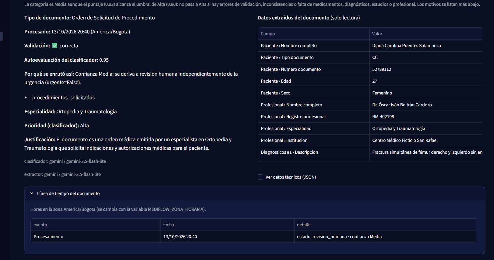
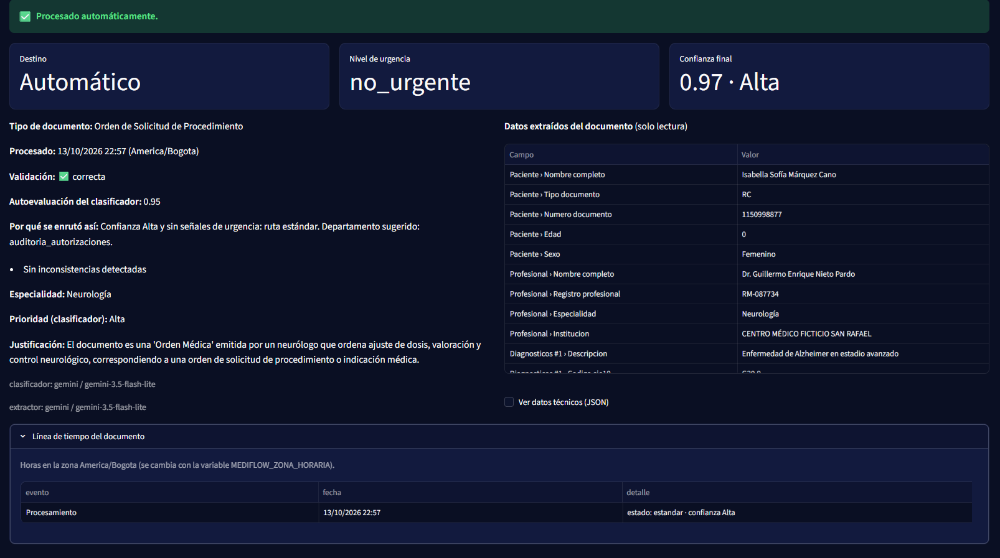
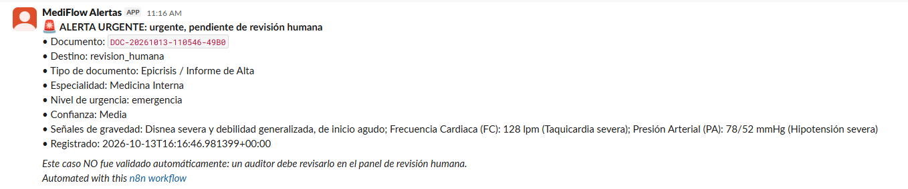
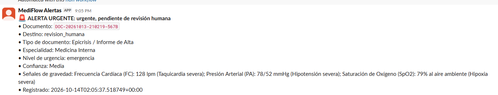
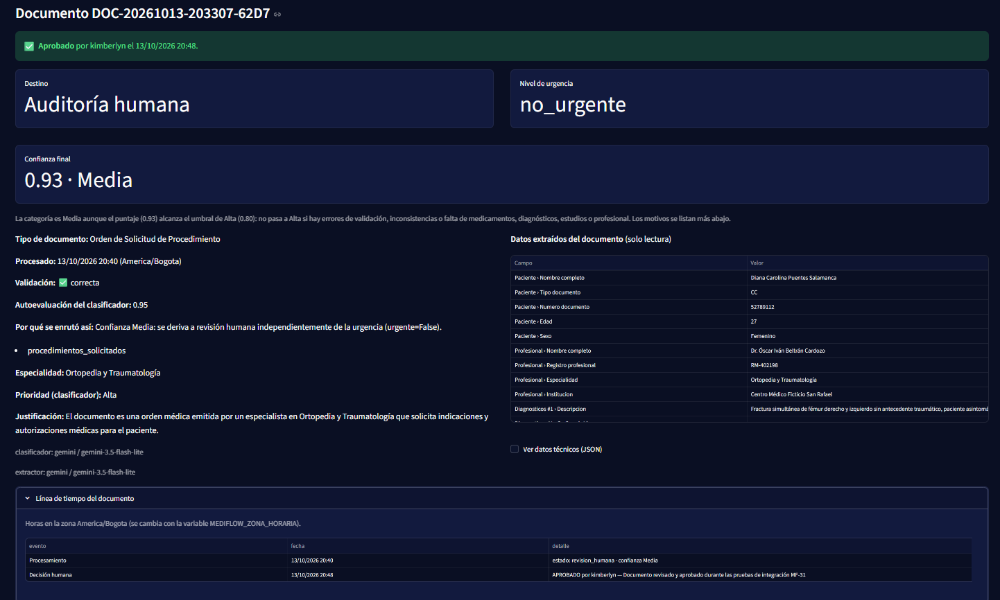
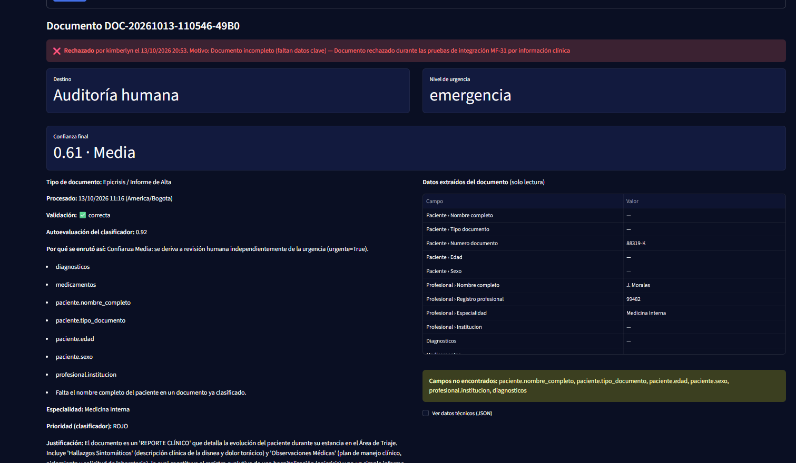
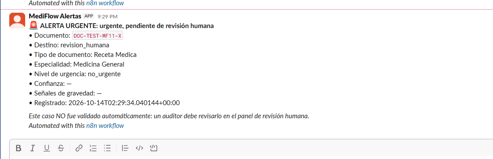

# MF-26 — Registro de pruebas, validaciones y hallazgos

**Actividad:** MF-26 — Pruebas y validación del flujo  
**Estado:** En progreso  
**Participantes:** Equipo MediFlow. Pruebas y hallazgos registrados por Kimberlyn, Jennifer y Kate.

## 1. Objetivo

Documentar los resultados de las pruebas funcionales realizadas sobre MediFlow, identificando comportamientos esperados, inconsistencias, problemas técnicos y posibles causas.

Este registro consolida los hallazgos obtenidos durante las pruebas del equipo y los análisis relacionados con MF-24 y MF-25.

La actividad permanece abierta, ya que todavía existen escenarios pendientes de validación e investigación.

## 2. Alcance de las pruebas

Las validaciones realizadas hasta el momento incluyen:

- Procesamiento y clasificación de documentos clínicos.
- Extracción de información.
- Evaluación de confianza y enrutamiento.
- Persistencia y consulta de resultados en OCI.
- Revisión humana (HITL), aprobación y rechazo.
- Alertas de emergencia mediante n8n, Slack y correo.

Las pruebas aquí registradas corresponden al entorno local, utilizando el backend FastAPI, la interfaz Streamlit y los servicios configurados para MediFlow.

## 3. Matriz de pruebas funcionales

Se consolidan los resultados obtenidos durante las validaciones realizadas por Kimberlyn y Jennifer. Los casos coincidentes se registran una sola vez, relacionándolos con las investigaciones correspondientes.

| Documento / escenario | Resultado esperado | Resultado obtenido | Evaluación |
|---|---|---|---|
| `caso-estandar.pdf` | Procesamiento como caso estándar | Clasificado como orden médica, confianza 0.93 Media y derivación a revisión humana. | Requiere análisis de clasificación — MF-25 |
| `caso-urgente.png` | Detección de urgencia | Clasificado como no urgente, con confianza 0.97 Alta y procesamiento automático. | Pendiente de análisis — MF-32 |
| `p10.jpg` | Identificación de contradicciones clínicas | No se identificó la contradicción entre el sexo masculino registrado y el diagnóstico de embarazo múltiple de 29 semanas. | No cumple el escenario esperado — MF-35 |
| `caso-urgente-inferido.jpg` | Detección de emergencia y envío de alertas | Emergencia detectada y alertas recibidas. | Satisfactorio |
| Reporte clínico urgente 2D | Detección de emergencia y enrutamiento seguro | Emergencia detectada, confianza 0.68 Media, revisión humana y alertas recibidas. | Satisfactorio con observaciones |
| `DOC-20261013-203307-62D7` | Aprobación de un documento desde HITL | Aprobación persistida y visible en Consulta de resultados. | Satisfactorio |
| `DOC-20261013-110546-49B0` | Rechazo de un documento desde HITL | Rechazo persistido y visible en Consulta de resultados. | Satisfactorio |
| `DOC-TEST-MF11-X` | Prueba automatizada aislada de notificaciones reales | El test generó una alerta real en Slack con confianza y señales vacías. | Reproducido — MF-24 |

### Observaciones

Los documentos `caso-estandar.pdf`, `caso-urgente.png` y `p10.jpg` contienen información clínica intencionalmente contradictoria, ya que fueron diseñados para evaluar la capacidad de MediFlow de identificar inconsistencias.

Por tanto, los resultados observados deben interpretarse considerando el propósito de cada prueba y no únicamente el nombre del archivo o el flujo esperado inicialmente.

La investigación de MF-25 permitió explicar la derivación de `caso-estandar.pdf` a revisión humana. Los comportamientos observados en `caso-urgente.png` y `p10.jpg` mantienen seguimiento en MF-32 y MF-35, respectivamente.

La reproducción de `DOC-TEST-MF11-X` permitió respaldar la hipótesis planteada durante MF-24.

Las pruebas de aprobación, rechazo y alertas en escenarios urgentes permitieron verificar funcionalidades importantes del flujo de MediFlow.

## 4. Hallazgos identificados durante las pruebas

### H01 — Documento estándar derivado a revisión humana

**Documento:** `caso-estandar.pdf`  
**Actividad relacionada:** MF-25  
**Estado:** Causa identificada; pendiente de determinar si requiere ajuste de clasificación.

Durante las pruebas de integración se observó que un documento utilizado como caso estándar fue derivado a revisión humana, con confianza numérica de 0.93 y categoría Media.

En paralelo, durante la investigación de MF-25, Jennifer identificó que el clasificador interpretaba el documento como una orden médica sin procedimientos solicitados. La ausencia de este campo provocaba una penalización en la evaluación de confianza y su posterior derivación a revisión humana.

En MF-25 se corrigió la evaluación de confianza para reconocer `estudios_solicitados` como equivalente a `procedimientos_solicitados` en órdenes médicas. Esta corrección ya fue integrada.

El documento `caso-estandar.pdf` contiene contradicciones clínicas deliberadas, por lo que su derivación a revisión humana no debe considerarse automáticamente incorrecta. La corrección implementada en MF-25 resolvió la equivalencia entre estudios y procedimientos solicitados, pero no modificó la clasificación documental inicial. Queda pendiente determinar si esta última requiere algún ajuste.

### H02 — Falso negativo en la detección de urgencia

**Documento:** `caso-urgente.png`  
**Estado:** Pendiente de investigación — MF-32.

El documento contiene información clínica intencionalmente contradictoria, incluyendo un paciente de 8 meses con diagnóstico de Alzheimer avanzado.

Durante las pruebas, MediFlow clasificó el documento como no urgente, con confianza 0.97 Alta y procesamiento automático.

Dado que el documento fue diseñado para evaluar el comportamiento del sistema ante inconsistencias clínicas, este resultado requiere analizarse en función de las reglas de detección de urgencia y validación de contradicciones definidas para el MVP.

**Seguimiento:** MF-32. No se considera resuelto ni se descarta el hallazgo por tratarse de datos sintéticos.

### H03 — Contradicción clínica no detectada

**Documento:** `p10.jpg`  
**Estado:** Pendiente de investigación — MF-35.

Jennifer identificó durante sus pruebas que el sistema no señaló una contradicción clínica deliberada en el documento.

El caso corresponde a un paciente registrado como masculino, con diagnóstico de embarazo múltiple de 29 semanas.

El documento fue diseñado específicamente para evaluar la detección de inconsistencias clínicas. El resultado observado evidencia que esta contradicción no fue identificada durante la prueba, por lo que corresponde revisar el alcance de las validaciones implementadas.

**Seguimiento:** MF-35. Hallazgo documentado, sin corrección aplicada.

### H04 — Alertas incompletas generadas durante pruebas automatizadas

**Documento de prueba:** `DOC-TEST-MF11-X`  
**Actividad relacionada:** MF-24  
**Estado:** Comportamiento reproducido; protección implementada.

Durante la investigación de MF-24, Jennifer identificó que una alerta incompleta observada durante la demostración del Sprint 3 podía haberse originado en una prueba automatizada que utilizaba un grafo simulado.

Para verificar esta hipótesis, se ejecutó localmente el test asociado a `DOC-TEST-MF11-X`, manteniendo activo el webhook de n8n.

La ejecución generó una alerta real en Slack con los campos «Confianza» y «Señales de gravedad» vacíos, reproduciendo el comportamiento observado.

La prueba confirma que este escenario puede generar alertas incompletas, aunque no permite asegurar que haya sido el origen exacto de la alerta histórica.

**Seguimiento realizado:** Se incorporó una protección en `tests/conftest.py` para evitar el envío de alertas reales durante las ejecuciones de pytest. La corrección fue integrada como parte de MF-24.

### H05 — Validación de documentos urgentes con revisión humana

**Documento de prueba:** `DOC-20261013-210219-567B`  
**Estado:** Validación satisfactoria con observaciones.

Se procesó un reporte clínico urgente en formato de imagen 2D.

El sistema identificó el nivel de emergencia, asignó confianza Media (0.68) y derivó el documento a revisión humana debido a información crítica faltante.

Las alertas se generaron correctamente, aun cuando el documento quedó pendiente de revisión humana.

Esto permitió validar que la derivación a HITL no impide la emisión de alertas correspondientes a casos urgentes.

### H06 — Persistencia de decisiones de revisión humana

**Documentos de prueba:**

- `DOC-20261013-203307-62D7`: aprobación.
- `DOC-20261013-110546-49B0`: rechazo.

**Estado:** Validado.

Se realizaron pruebas de aprobación y rechazo desde el panel de revisión humana.

En ambos escenarios se verificó que las decisiones quedaran registradas y fueran recuperables desde Consulta de resultados.

### H07 — Optimización del tiempo de conexión local de Streamlit

**Actividad relacionada:** MF-33 (GitHub Issue #69)  
**Responsable:** Mauricio Niño  
**Estado:** Mejora implementada, probada localmente e integrada.

Durante las validaciones del frontend se identificó una oportunidad de mejora en el tiempo de respuesta del panel cuando la API local no se encuentra disponible.

Mauricio implementó un ajuste para utilizar `127.0.0.1` como dirección predeterminada de conexión.

**Resultados reportados:**

- Tiempo de espera anterior: aproximadamente 30 segundos.
- Tiempo de espera posterior: aproximadamente 20 segundos.
- Comportamiento de reintentos: sin modificaciones.
- Pruebas automatizadas: 342 satisfactorias.

La mejora representa una reducción aproximada de 10 segundos en el escenario evaluado.

**Seguimiento:** MF-33 fue implementada e integrada mediante pull request.

### Pruebas adicionales de MF-29 — Kate

Kate realizó 19 corridas por la API (`POST /documentos`) y 9 por la pantalla de Carga de Streamlit, registrando cinco hallazgos en el issue de MF-26 (#62). Los resultados detallados y los pasos de reproducción se encuentran en su planilla adjunta y en la documentación de MF-29.

| Hallazgo | Documento | Resultado observado | Impacto / seguimiento |
|---|---|---|---|
| K01 — Variación de señales de gravedad | `02_informe_estudio.txt` | Se obtuvieron dos señales en algunas corridas y una en otras. Se mantuvieron el destino cola_urgencias_medicas y la confianza Alta 0.93.| Bajo. Registrar variación; evitar prometer una cantidad fija de señales. |
| K02 — Visualización incompleta en Consulta | `02_informe_estudio.txt` | La pantalla no muestra el departamento de destino de los urgentes ni las señales de gravedad; estas últimas están disponibles en el JSON técnico. | Medio para la demo. Posible mejora de interfaz; pendiente de evaluar si requiere tarea. |
| K03 — Tipo de archivo TXT | `01_receta_medica.txt` | El campo tipo_archivo del historial de la API registra el valor «JSON», mientras que la pantalla de Carga de Streamlit muestra text/plain. Se documenta la diferencia entre ambas representaciones. | Bajo. Limitación de visualización conocida en MF-28. |
| K04 — Variación de confianza y señal de gravedad | `caso-ambiguo.pdf` | En tres corridas se obtuvo `revision_humana`, con confianza Media 0.93 / 0.88 / 0.93. La frase «Urgencia: no urgente» apareció como señal de gravedad. | Bajo. El destino fue estable; queda registrada la inconsistencia en el puntaje y las señales. |
| K05 — Variación de enrutamiento | `07_informe_estudio.png` | En cuatro corridas, tres derivaron a `revision_humana` (Media 0.88) y una a urgente directo (Alta 0.93). | Medio. No se propone como documento definitivo para la demo por su comportamiento variable. |

Kate también confirmó resultados satisfactorios en los documentos `01_receta_medica.txt`, `02_informe_estudio.txt`, `09_receta_inconsistente_hitl.txt`, `07_urgente_receta_mf24.txt`, `06_receta_medica.pdf` y `08_orden_procedimiento.jpg`.

Estos resultados complementan las validaciones ya registradas. No se repiten como nuevas pruebas de integración ni se generan actividades duplicadas para `caso-urgente.png` y `p10.jpg`, que mantienen seguimiento en MF-32 y MF-35.

## 5. Seguimiento de hallazgos

| Hallazgo | Referencia | Estado / seguimiento |
|---|---|---|
| Clasificación de `caso-estandar.pdf` | MF-25 | Documento sintético con contradicciones deliberadas. Corrección de equivalencias integrada; clasificación inicial pendiente de evaluación. |
| Clasificación de `caso-urgente.png` | MF-32 | Caso sintético contradictorio; pendiente analizar detección de urgencia e inconsistencias. |
| Contradicción no detectada en `p10.jpg` | MF-35 | Embarazo múltiple en paciente masculino; pendiente analizar detección de inconsistencias. |
| Alertas reales durante pytest | MF-24 | Protección implementada e integrada en `tests/conftest.py`. |
| Urgencia + HITL + alertas | MF-26 | Escenario validado; conservar evidencia. |
| Aprobación y rechazo HITL | MF-26 | Escenarios validados; conservar evidencia. |
| Optimización de conexión local | MF-33 | Mejora implementada e integrada. |
| Variación de señales de gravedad | MF-29 / MF-26 | K01. Observación de bajo impacto; destino urgente estable. |
| Visualización de datos de urgencia en Consulta | MF-29 / MF-26 | K02. Mejora potencial de interfaz; pendiente de evaluar. |
| Identificación de archivos TXT como JSON | MF-29 / MF-26 | K03. Limitación conocida de visualización. |
| Variación de confianza en `caso-ambiguo.pdf` | MF-29 / MF-26 | K04. Observación de bajo impacto; HITL estable. |
| Variación de enrutamiento en `07_informe_estudio.png` | MF-29 / MF-26 | K05. Observación de impacto medio; no usar como caso definitivo de demo. |

## 6. Estado de la actividad

MF-26 continúa en progreso.

Se han identificado comportamientos funcionales satisfactorios y hallazgos que requieren seguimiento.

Los resultados coincidentes entre las pruebas de integración y las investigaciones realizadas por Jennifer se consolidan en este registro para mantener la trazabilidad y evitar duplicar incidencias.

Los hallazgos pendientes de investigación se encuentran identificados en MF-32 y MF-35. Las correcciones correspondientes a MF-24, MF-25 y MF-33 ya fueron integradas.

Los documentos sintéticos con contradicciones deliberadas se mantienen como casos de prueba válidos para evaluar la detección de inconsistencias. Su análisis y posible corrección se gestionan mediante los hallazgos correspondientes, sin bloquear la documentación de las demás pruebas satisfactorias de MF-26.

## 7. Evidencias de las pruebas

Las evidencias se incorporarán progresivamente conforme se organicen las capturas y registros de las validaciones realizadas.

| Caso evaluado | Evidencia a incorporar | Referencia |
|---|---|---|
| `caso-estandar.pdf` | Captura de clasificación, confianza y derivación a HITL. |  |
| `caso-urgente.png` | Captura del resultado de clasificación como no urgente. |  |
| `p10.jpg` | Documento original y resultado donde no se identifica la contradicción clínica. | **[Pendiente: evidencia de p10.jpg — hallazgo reportado por Jennifer]** |
| `caso-urgente-inferido.jpg` | Captura de detección de emergencia y alerta recibida. | **Documento utilizado:** [caso-urgente-inferido.jpg](assets/sprint-4/MF-26/caso-urgente-inferido.jpg)  |
| Reporte clínico urgente 2D | Resultado en Consulta y alerta de Slack. | **Documento utilizado:** [reporte-urgente-inferido-2d.png](assets/sprint-4/MF-26/reporte-urgente-inferido-2d.png)  |
| Aprobación y rechazo HITL | Capturas de las decisiones registradas y consultadas. | **Aprobación HITL:**  **Rechazo HITL:**  |
| `DOC-TEST-MF11-X` | Captura de Slack con confianza y señales de gravedad vacías. | **Actividad relacionada:** MF-24  |
| Optimización de conexión local de Streamlit (MF-33) | Mediciones antes y después del ajuste de `127.0.0.1`, con 342 pruebas satisfactorias reportadas por Mauricio. | **[Pendiente: evidencias de Mauricio en MF-33 / Issue #69]** |

**Nota:** Los espacios señalados se completarán con las capturas, rutas de archivos o enlaces correspondientes. Los hallazgos relacionados con MF-32 y MF-35 se mantienen abiertos para seguimiento.