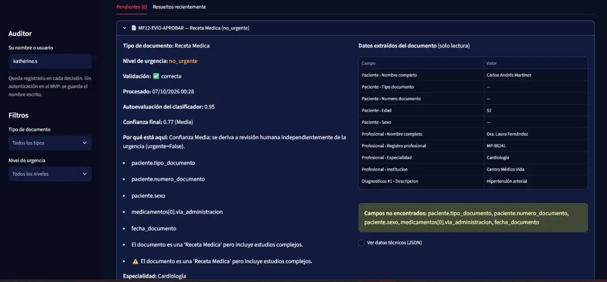
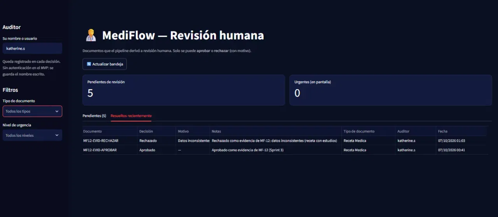
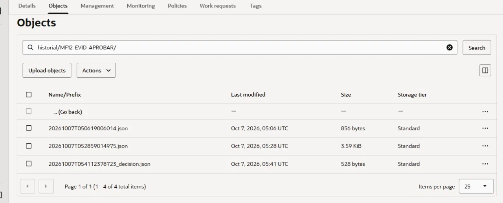
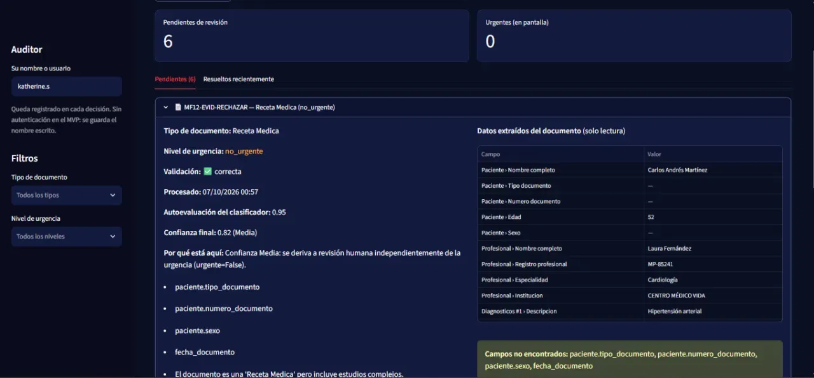
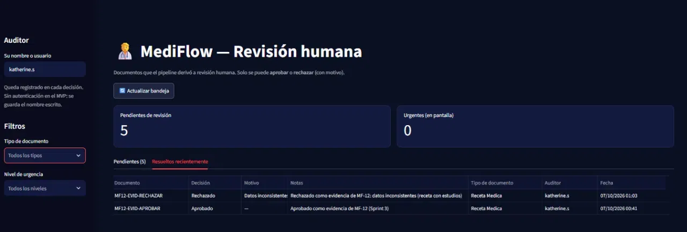
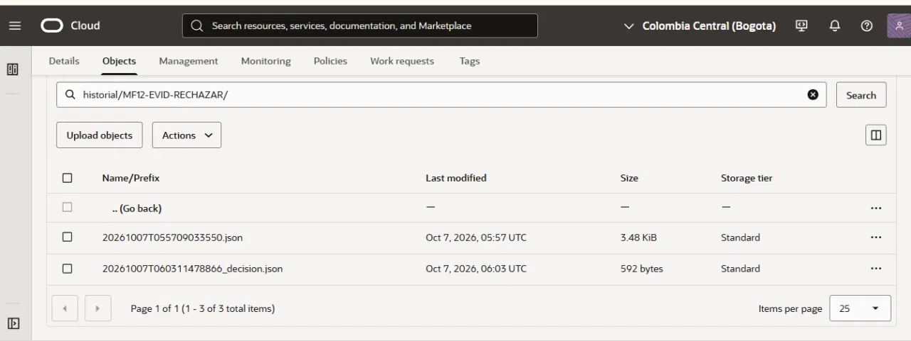
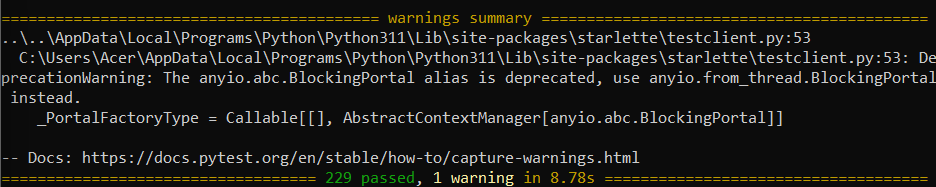
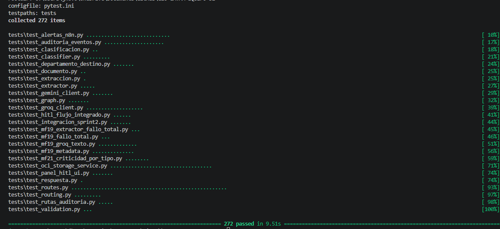

# Evidencias de validación — Sprint 3

> Evidencias del cierre del Sprint 3, validadas sobre `develop` con todas las actividades integradas (incluido el PR #57 de MF-17).

## Alcance

Este documento reúne la validación del mecanismo de revisión humana (HITL, MF-12) contra el bucket real de OCI Object Storage, usando la versión integrada en `develop` (PR #47 con los métodos de OCI y PR #48 con el panel y la API de auditoría).

Se usó el caso controlado del Sprint 2, `09_receta_inconsistente_hitl.txt`, que se presenta como receta médica pero incluye un estudio solicitado y por eso se deriva a revisión humana. Se procesó con dos `documento_id` distintos, porque una decisión no se puede repetir sobre el mismo ciclo:

- `MF12-EVID-APROBAR`
- `MF12-EVID-RECHAZAR`

El caso `TEST-MF20-FINAL-HITL` (evidencia del Sprint 2) no se modificó.

Este documento distingue dos tipos de validación: las pruebas E2E del equipo en MF-17, que incluyen las alertas reales por Slack y correo, y la verificación posterior e independiente en un equipo local, donde no se reprodujeron las alertas externas (ver «Verificación posterior en equipo local»).

---

## Escenario HITL — APROBAR

**Documento:** `09_receta_inconsistente_hitl.txt`  
**ID:** `MF12-EVID-APROBAR`

El documento se procesó con destino `revision_humana` y apareció como caso pendiente en el panel.

El revisor lo **aprobó** desde el panel. La decisión se guardó como un evento nuevo en `historial/MF12-EVID-APROBAR/`, sin sobrescribir ningún objeto anterior.

Se verificó directamente en OCI Object Storage el objeto `_decision.json`:

[Ver decisión JSON](assets/sprint-3/respuesta-hitl-aprobar.json)

---

## Escenario HITL — RECHAZAR

**Documento:** `09_receta_inconsistente_hitl.txt`  
**ID:** `MF12-EVID-RECHAZAR`

El documento se procesó con destino `revision_humana` y apareció como caso pendiente en el panel.

El revisor lo **rechazó** con motivo `INCONSISTENTE` y una nota (las notas son obligatorias al rechazar). La decisión se guardó como un evento nuevo en `historial/MF12-EVID-RECHAZAR/`.

Se verificó directamente en OCI Object Storage el objeto `_decision.json`:

[Ver decisión JSON](assets/sprint-3/respuesta-hitl-rechazar.json)

---

## Huella del contenido (MF-22)

Ambas decisiones incluyen `huella_sha256`, copiada del evento de procesamiento sobre el que se decidió, solo para trazabilidad. Como los dos casos usan el mismo archivo de entrada, la huella coincide (`93bdb8c5…8cf73c9`).

---

## Observaciones de la prueba

- `MF12-EVID-APROBAR` tiene un evento extra en `historial/` y un objeto en `errores_tecnicos/MF12-EVID-APROBAR.json`: el primer envío falló porque el `.env` local no tenía las claves de Gemini (no fue un fallo del código). El segundo envío salió bien y es el que referencia la decisión (`evento_referencia`).
- El panel muestra hora de Bogotá y el bucket usa UTC (5 horas de diferencia).

---

## Pruebas automatizadas

Con el panel y los métodos de OCI integrados, la suite pasó 229 pruebas (191 existentes más 38 de MF-12). Con todas las actividades del Sprint 3 integradas, la validación final de MF-17 reporta **272 de 272 pruebas aprobadas**.

---

## Dataset ampliado (MF-16)

Casos realistas en PDF e imagen, en `docs/assets/mf-16/`:

| Caso | Escenario | Formato |
|---|---|---|
| `caso-estandar.pdf` | Estándar (flujo normal, paciente estable) | PDF |
| `caso-urgente.png` | Urgente explícito (etiqueta de prioridad en el documento) | Imagen |
| `caso-urgente-inferido.png` | Urgencia inferida por signos clínicos, sin etiqueta de prioridad | Imagen |
| `caso-ambiguo.pdf` | Datos contradictorios, para revisión humana (ajustado en MF-17 para provocar la inconsistencia de forma reproducible) | PDF |

Documentación: `docs/MF-16-dataset-casos-prueba.md` y `docs/MF-16-arquitectura-dataset.md`.

---

## Otras actividades del Sprint 3

| Actividad | Qué se validó | Documento |
|---|---|---|
| MF-14 Alertas con n8n | Alerta por Slack y correo para casos urgentes, sin bloquear el flujo si fallan | [MF-14-alertas-n8n.md](MF-14-alertas-n8n.md) |
| MF-21 Confianza por tipo documental | Matriz de criticidad por tipo; 8 pruebas de regresión en MF-17 | [MF-21-confianza-por-tipo-documental.md](MF-21-confianza-por-tipo-documental.md) |
| MF-23 Departamento destino | Campo `departamento_destino` en API, historial y persistencia | [MF-23-enrutamiento-departamento.md](MF-23-enrutamiento-departamento.md) |

---

## Validación E2E y regresión final (MF-17)

Resumen de lo validado (detalle y capturas en [MF-17-validacion-e2e-regresion.md](MF-17-validacion-e2e-regresion.md), integrado en el PR #57):

| Escenario | Resultado |
|---|---|
| Flujo estándar y urgente, e inferencia de urgencia | OK |
| HITL — aprobación (con historial) | OK |
| HITL — rechazo (con historial) | OK |
| Trazabilidad SHA-256 | OK |
| Persistencia e historial en OCI | OK |
| Confianza (MF-21): 8 pruebas | OK |
| Fallback técnico: 33 pruebas | OK |
| Alertas reales por Slack (`#mediflow-alertas-urgentes`) y correo | OK |
| Suite completa: 272/272 | OK |

Flujo de alertas validado: `Documento → API → procesamiento → revisión humana + urgencia → persistencia OCI → n8n → Slack + correo`.

---

## Demostración del Sprint 3 y hallazgos (08/10/2026)

En la demo de cierre se mostraron los tres flujos sobre `develop`, con persistencia e historial en OCI, alertas reales por Slack y correo, y el panel HITL con registro de decisión.

| Flujo | Resultado en la demo | Estado |
|---|---|---|
| Estándar | Recorrido completo; el documento elegido para la demo se derivó a revisión humana | Hallazgo → Sprint 4 (revisar derivación) |
| Urgente | Recorrido y alertas reales demostrados; confianza y señales de gravedad se mostraron como guiones en la receta | Hallazgo → Sprint 4 (investigar causa) |
| Revisión humana (HITL) | Resolución y trazabilidad de la decisión registradas | OK |
| Regresión | Suite de 272 pruebas aprobadas | OK |
| Alertas | Slack y correo reales; persistencia e historial en OCI | OK |

Los dos hallazgos quedan registrados para su investigación en el Sprint 4; no se consideran resueltos por el cierre del Sprint 3.

---

## Verificación posterior en equipo local

Estas pruebas son independientes de las E2E de MF-17 y no forman parte de esa validación. Con `develop` actualizado (incluido el PR #57) se repitió la validación de forma independiente en un equipo local: suite de pruebas **272/272 aprobadas**; carga de `caso-ambiguo.pdf` por `POST /documentos` (derivado a `revision_humana`, con `persistencia_ok` e `historial_ok` en `true`); aparición del caso en el panel y registro de la decisión de rechazo con motivo y notas. En estas pruebas independientes no se reprodujeron las alertas externas de Slack ni de correo, porque dependen de la configuración de n8n del equipo; las alertas reales se validaron únicamente en las pruebas E2E de MF-17.

**Hallazgo pendiente de reproducir y analizar en el Sprint 4:** al registrar una decisión de revisión humana, el panel mostró un aviso de tiempo de espera agotado y la decisión igual quedó guardada. Todavía no se reprodujo ni se analizó su causa, por lo que no se presenta como un error confirmado. Mientras tanto, conviene actualizar la bandeja antes de repetir una decisión.
